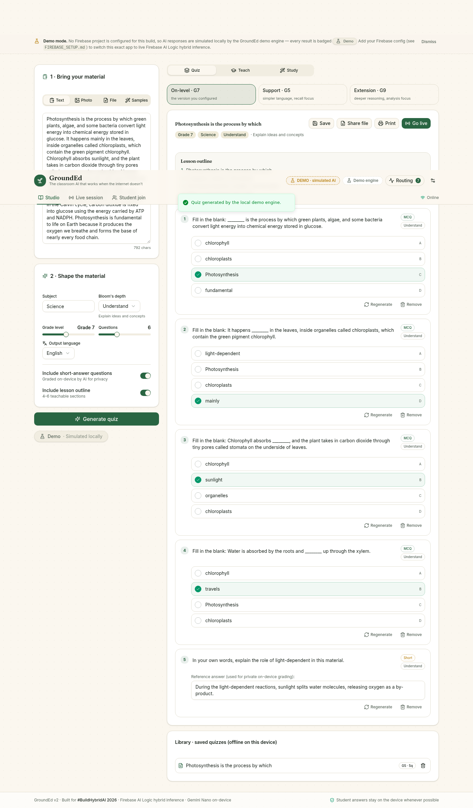
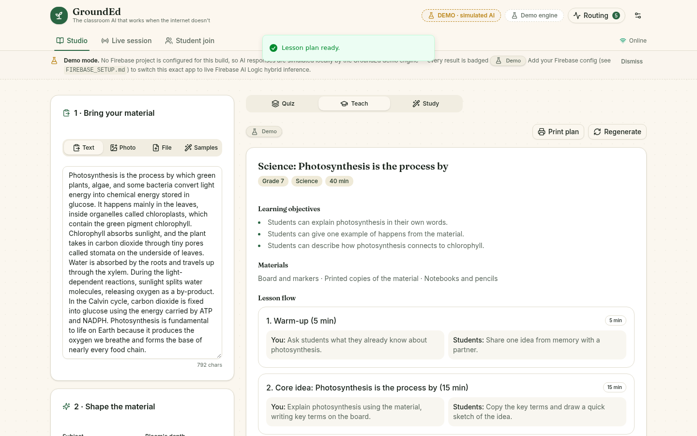
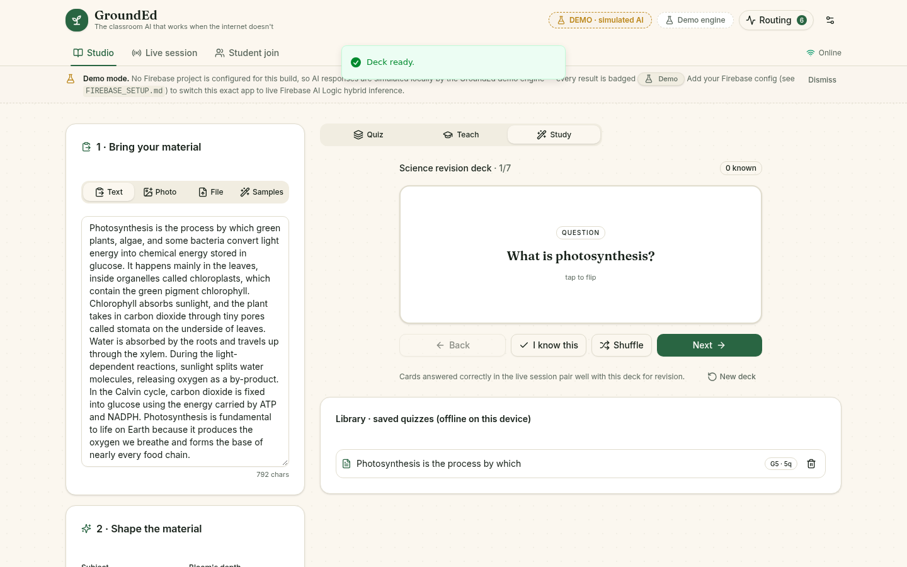
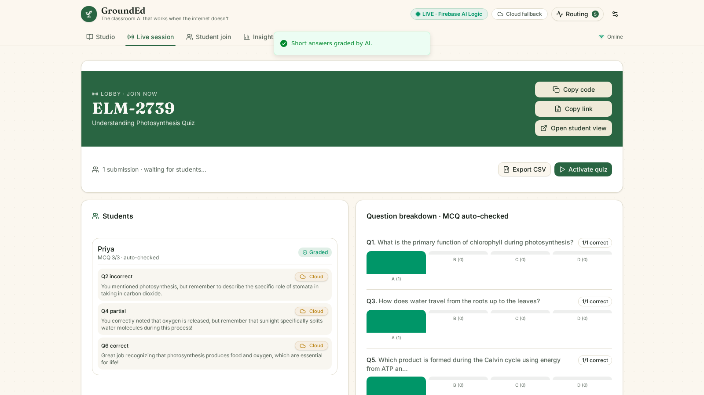
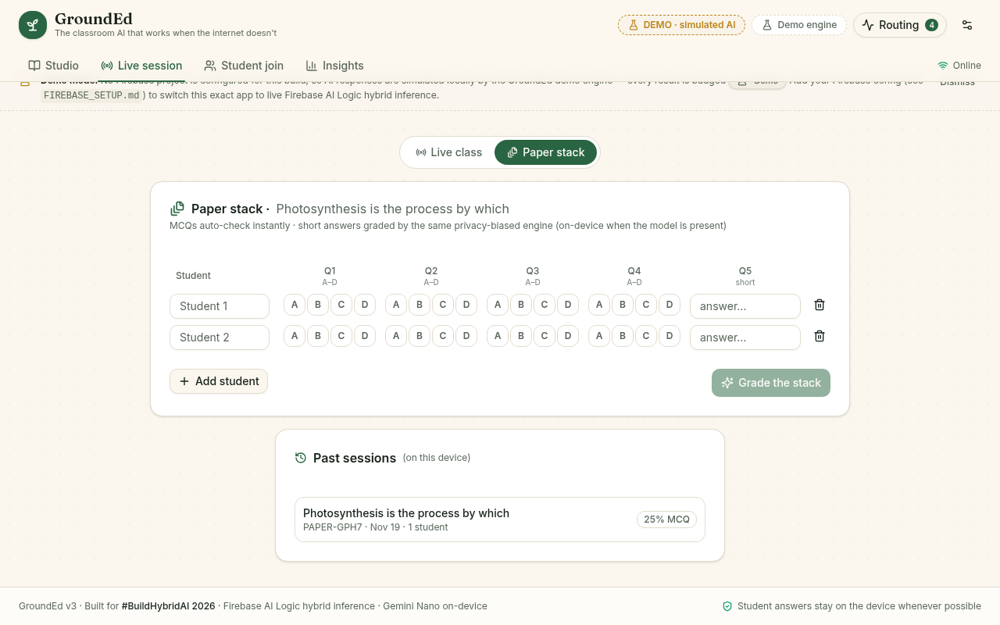
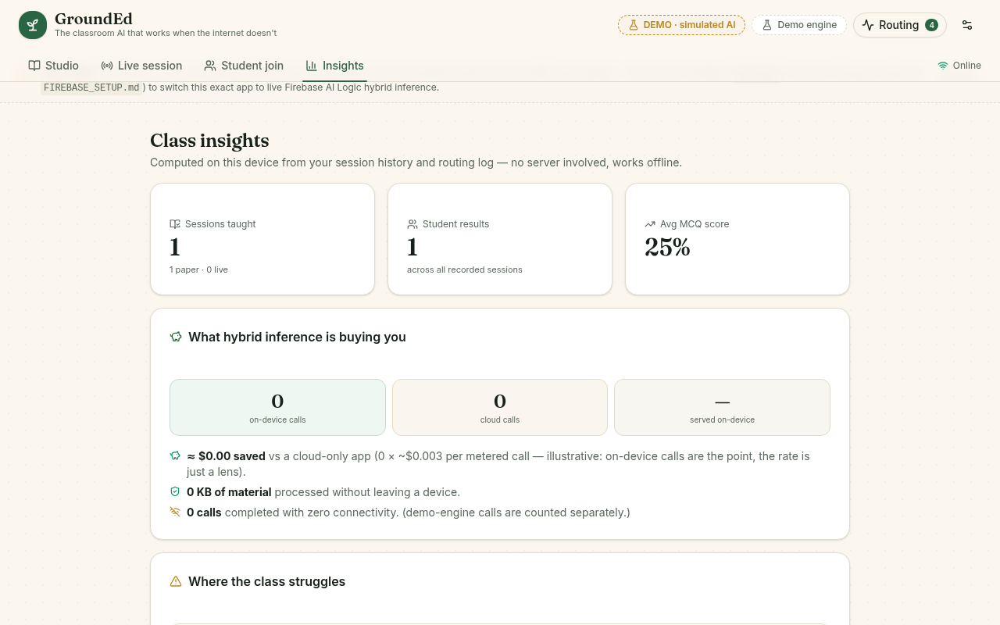

<div align="center">

# GroundEd

**The classroom AI that works when the internet doesn't.**

An offline-first teaching kit for low-connectivity classrooms: **quizzes,
lesson plans and flashcards** from any material (paste, photo or PDF) — with
private on-device grading, **paper-stack grading**, live sessions that
survive airplane mode, **class analytics with a hybrid-value meter**, and
answer keys verified on the *other* tier.

`#BuildHybridAI 2026` · Built on **Firebase AI Logic hybrid inference**

[](https://github.com/mir-ashiq/GroundEd/actions/workflows/ci.yml)
[](LICENSE)
[](https://grounded-hybrid.web.app/demo/GroundEd_demo_video.mp4)

[Live demo](https://grounded-hybrid.web.app) · [Open the Studio](https://grounded-hybrid.web.app/studio/) · [60-second judge tour](#60-second-tour) · [Setup](FIREBASE_SETUP.md) · [Changelog](CHANGELOG.md)

</div>

---

## 60-second tour

| # | See it | Where |
| --- | --- | --- |
| 1 | One material → **quiz + lesson plan + flashcards**, each badged with where the AI ran | [Studio](https://grounded-hybrid.web.app/studio/) → generate, then the Teach/Study tabs |
| 2 | **Cross-tier verification**: quiz generated on-device → its answer key re-derived in the cloud (and vice versa); the routing log says which keys got caught | Generate a quiz, open **Routing** |
| 3 | **Differentiated versions**: Support (−2 grades) and Extension (+2 grades) of the same quiz, one click each | Quiz tab → the three level chips |
| 4 | **Airplane mode**: generate, grade and keep working with zero bars (static shell + service worker + Firestore offline cache + on-device model) | Settings → *Prepare offline AI*, then go offline |
| 5 | **Live class**: 6-character join code, instant MCQ scores for students, AI-graded short answers, CSV export, session history | Live session tab |
| 6 | **Paper mode**: print the worksheet, students answer on paper, teacher types the stack once — MCQs auto-check, short answers AI-graded offline | Live session → *Paper stack* |
| 7 | **Insights**: sessions, student results, MCQ trend, the class's weakest questions — plus a hybrid-value meter (on-device calls, illustrative savings, KB kept local) and a runnable **Verification Lab** | Insights tab |
| 8 | **Honesty by design**: DEMO mode labels every simulated response; the badge comes from the SDK's `inferenceSource`, never a guess | Run locally with no config |



*Studio: quiz with Support / Extension versions of the same material.*


*Teach: a timed lesson plan from the same material.*


*Study: a revision deck from the same material.*

## The problem

AI teaching tools assume the cloud. Classrooms — across much of India, Africa,
Southeast Asia, and rural everywhere — cannot rely on stable connectivity, and
per-call API pricing is invisible budget poison for schools. Meanwhile the
most widely used quiz platforms only support *solo* offline study, not
teacher-led live sessions.

A teacher's real week is bigger than quizzes: the lesson plan comes first,
the quiz comes second, revision comes after, and every class is mixed-ability.
**GroundEd is the teaching kit that stays useful with zero bars:** one
imported material becomes a full lesson plan, a quiz (in three difficulty
versions) with a cross-verified answer key, a printable worksheet, a flashcard
deck — and a live session that queues answers offline and syncs when
connectivity returns.

## Why hybrid inference — and why *this* shape of hybrid

Every AI action runs through **Firebase AI Logic hybrid inference** and shows
where it executed: `ON_DEVICE` (Gemini Nano — private · free · offline) or
`CLOUD` (Gemini fallback).

| AI feature | On-device tier | Cloud tier | Default policy |
| --- | --- | --- | --- |
| Quiz / plan / deck generation | ✅ airplane mode, private, free | ✅ long documents, non-English output | `PREFER_ON_DEVICE` |
| Short-answer grading | ✅ **student answers never leave the device when the model is present** | only as fallback (badged honestly) | `ONLY_ON_DEVICE` when ready |
| **Answer-key verification** | ✅ verifies what the cloud generated | ✅ verifies what the device generated | **always the OTHER tier** |

Three design decisions make the hybrid architecture *matter* rather than
decorate:

1. **Cross-tier verification.** Small models occasionally mark a distractor
   as the correct answer. Re-checking on the same tier that made the mistake
   would catch little — so GroundEd re-derives every answer key on the
   *opposite* tier. Generated on-device → verified in the cloud; generated in
   the cloud → verified on-device. Two independent brains, by design.
2. **Privacy-biased grading.** Student work is the most sensitive data in a
   school. Grading defaults to `ONLY_ON_DEVICE` whenever the local model is
   present; if the teacher's browser has no local model, the fallback runs
   and the badge says so — never silently.
3. **The offline tier is the product.** Remove the on-device tier and GroundEd
   collapses into Yet Another Cloud Quiz Tool — one that dies exactly where
   its audience lives. Remove the cloud tier and long documents, non-English
   output and cross-checking disappear. Both tiers earn their keep.

**Why not cloud-only?** Cost (per-call pricing vs ₹0 on-device — see the honest
math below), privacy (children's answers), and connectivity (the whole point).
**Why not fully local?** The on-device tier caps context, is English-biased,
and cannot cross-check itself. Hybrid is not a compromise; it is the design.

### The honest cost math (illustrative)

A 30-student class, 5 quizzes a week, ~25 AI calls per quiz-and-grade cycle:

- **Cloud-only**: ~3,750 paid model calls/week for a single class — recurring,
  metered, in a currency schools in the target audience don't budget in.
- **GroundEd hybrid**: generation and grading served on-device for ₹0 after a
  one-time model download; the cloud tier only handles what the device can't
  (long docs, non-English, cross-verification). Firestore/Auth/Hosting for a
  classroom-scale deployment sit comfortably in Firebase's free tiers.
  Numbers vary with usage; the structural point doesn't: on-device calls are
  free, and they are the majority. The **Insights tab turns this into a live
  meter** — it counts every on-device call you actually made, estimates what
  a cloud-only app would have metered, and shows how much material never
  left the device.

## Feature tour

- **Studio** — import material (paste / photograph / `.txt` / `.md` / **PDF,
  text-layer extracted in the browser** / a shared `.grounded.json` quiz /
  samples), pick grade level (3–12), Bloom's depth, question mix and output
  language (**English, Hindi, Tamil, Telugu, Bengali, Marathi**); generate a
  quiz; edit any question, mark correct answers, regenerate individual
  questions, **explain any question at a chosen reading level** (with an
  everyday analogy, readable aloud).
- **Teach** — a full timed lesson plan from the same material: objectives,
  materials, per-section *you do / students do*, homework, support &
  extension notes. Printable.
- **Study** — a flashcard deck from the same material, scheduled by **SM-2
  spaced repetition** (the algorithm behind Anki): Again / Hard / Good /
  Easy, due-first queue, mastered at a 3-week gap, progress persisted per
  device. Cards can be **read aloud** (on-device speech synthesis) for
  younger and low-literacy readers.
- **Differentiation** — Support (grade −2, recall) and Extension (grade +2,
  analysis) versions of the same quiz, switchable losslessly.
- **Printable worksheet** — real print CSS: name/date lines, MCQ option grids,
  short-answer rule lines, and a separate answer-key page.
- **Live sessions** — 6-character join code, mobile-first student flow with
  **read-aloud questions**, per-question answer distributions, MCQ
  auto-checked deterministically with **instant student scores**, short
  answers graded by AI with per-call routing badges, **CSV export** and
  **session history** with class stats.
- **Paper mode** — the audience's most common medium, end-to-end: print the
  worksheet, students answer on paper, the teacher types the stack in once
  (MCQs become A–D taps). MCQs auto-check; short answers go through the same
  privacy-biased hybrid grading engine — gradeable with **zero student
  devices and zero connectivity**. CSV export + history, side by side with
  live sessions.
- **Insights** — the teacher's class dashboard, computed locally from
  history + the routing log: sessions taught (live vs paper), student
  results, average MCQ trend, and the questions the class keeps getting
  wrong (weighted across sessions). The **hybrid-value meter** makes the
  architecture pay visibly: on-device vs cloud call counts, illustrative
  savings vs a cloud-only app, KB of material kept local, and offline
  completions. The **Verification Lab** makes the trust story runnable —
  plant a wrong answer key and watch the cross-tier check catch it (demo),
  or re-run the real check on the current quiz (live).
- **Routing inspector** — every AI call logged with the SDK-reported
  `inferenceSource`, model, latency, offline status and notes (including
  cross-tier verification results). The log persists across refreshes.
- **Offline sharing** — quizzes export as `.grounded.json` files;
  teacher-to-teacher sharing needs no server at all.
- **Demo mode** — with zero Firebase configuration the entire product runs on
  a local simulation engine, **honestly badged `DEMO`**, so anyone can try the
  full flow before wiring a Firebase project.



*Live session: join code, auto-checked MCQs, AI grading, CSV export.*


*Paper mode: no student devices — type the class's paper answers once, AI grades the stack.*


*Insights: class analytics, weakest questions, the hybrid-value meter and the Verification Lab.*

## Quickstart

```bash
npm install
cp .env.example .env.local   # optional — leave empty for DEMO mode
npm run dev                  # http://localhost:3000
npm test                     # vitest suite (demo engine, repair layer, CSV,
                             #   insights math, SM-2 scheduler)
```

For **LIVE mode** (real Firebase AI Logic + hosting), follow
**[FIREBASE_SETUP.md](FIREBASE_SETUP.md)** — a zero-experience runbook
(~45 min). The hosted deployment runs LIVE mode by default.

## Who can run this today (no hand-waving)

- **Cloud tier + everything else (sessions, offline queue, printing):** any
  modern browser, zero setup.
- **On-device tier:** Chrome Desktop 139+ with the Prompt API flag for
  Gemini Nano, plus a one-time model download from Settings. On Android,
  Gemini Nano needs supported hardware (Pixel 10/11, Galaxy S26+) — the
  Android companion is on the roadmap with the same Firebase project.
- **Judges without the flag:** everything still works via cloud fallback, and
  the badge explains exactly why it routed there.

## How hybrid inference carries the product

```
                          ┌──────────────────────────────────┐
                          │        GroundEd (web app)        │
                          └──────────────────────────────────┘
   material (text/photo/file)                      teacher policy
          │                                              │
          ▼                                              ▼
  ┌─────────────────┐    PREFER_ON_DEVICE    ┌──────────────────────┐
  │ Firebase AI Logic│ ─────────────────────▶ │ Gemini Nano (device) │  private · free · offline
  │  (getAI /        │                        └──────────────────────┘
  │   getGenerative  │        fallback        ┌──────────────────────┐
  │   Model)         │ ─────────────────────▶ │ Gemini (cloud)       │  long docs · non-English
  └─────────────────┘                        └──────────────────────┘
          │ response.inferenceSource ──▶ the routing badge (never a guess)
          ▼
  structured output (JSON schema enforced on BOTH tiers)
          │
          ├── quiz ──▶ answer keys re-derived on the OTHER tier (cross-check)
          ├── Firestore (offline persistence) ── sessions & queued answers
          ├── Authentication ── teachers (Google) & students (anonymous)
          ├── Remote Config ── prompts + routing policy, hot-updatable
          └── App Check ── attestation on every AI call (debug tokens in dev)
```

### Where Firebase AI Logic is imported and called (runtime use)

| What | Where |
| --- | --- |
| SDK import (`getAI`, `getGenerativeModel`, `GoogleAIBackend`, `InferenceMode`) | [`src/lib/grounded/aiEngine.ts`](src/lib/grounded/aiEngine.ts) — top imports |
| Hybrid model construction (mode + `inCloudParams` + `onDeviceParams`) | `aiEngine.ts` → `getHybridModel()` |
| Quiz generation (text & multimodal photo) | `aiEngine.ts` → `generateQuiz()` |
| Lesson plan generation | `aiEngine.ts` → `generateLessonPlan()` |
| Flashcard generation | `aiEngine.ts` → `generateFlashcards()` |
| Short-answer grading (device-biased for privacy) | `aiEngine.ts` → `gradeAnswer()` |
| Concept re-explanation at a reading level (device-preferred) | `aiEngine.ts` → `explainConcept()` |
| **Cross-tier answer-key verification** | `aiEngine.ts` → `verifyAnswerKeys()` |
| On-device model download (user-gesture initiated) | `aiEngine.ts` → `prepareDeviceModel()` |
| Routing truth: `response.inferenceSource` | `aiEngine.ts` → read in every call path |
| Structured-output schemas for both tiers | [`src/lib/grounded/schemas.ts`](src/lib/grounded/schemas.ts) |

### Firebase products used

| Product | Role in GroundEd |
| --- | --- |
| **AI Logic (hybrid)** | All generative AI: on-device Gemini Nano + cloud fallback, structured output on both tiers |
| **App Check** | Mandatory attestation for AI Logic; reCAPTCHA v3 in production, debug tokens in development |
| **Authentication** | Teachers via Google sign-in (optional) or anonymous; students anonymous (gates Firestore writes) |
| **Firestore** | Live sessions + submissions with `persistentLocalCache` — offline writes queue in IndexedDB and sync on reconnect |
| **Remote Config** | Prompt templates, routing policy, cloud model id — tunable without redeploying (cache keys include RC values) |
| **Hosting** | The public URL judges open (static export + service worker for offline reload) |

## Repository map

```
src/
  app/                      Landing (server) + the app at /studio (client-side,
                            offline-capable experience)
  components/grounded/      AppShell, Studio (Quiz/Teach/Study), Live (+ Paper
                            mode), Student, Insights, ExplainDialog,
                            RoutingBadge, ErrorBoundary
  lib/grounded/
    aiEngine.ts             Firebase AI Logic hybrid engine (LIVE)
    demoEngine.ts           Honest local simulation + quiz repair layer (DEMO)
    firebase.ts             Real-first init: AI, App Check, Auth, Firestore, RC
    schemas.ts              Structured-output schemas (both tiers)
    prompts.ts              Prompt templates (Remote Config overridable)
    sessions.ts             Transport: Firestore | BroadcastChannel; CSV; share files
    insights.ts             Insights math: hybrid-value meter, class stats, weak spots
    srs.ts                  SM-2 spaced-repetition scheduler (pure + persisted)
    pdf.ts / pdfTypes.ts    In-browser PDF text extraction (pdf.js, local worker)
    speech.ts               Read-aloud via on-device speech synthesis
    store.ts                Zustand state (routing log + history persist)
tests/                      vitest: demo engine, repair layer, session utils,
                            insights math, SM-2 scheduler
firestore.rules             Security rules (auth-gated submissions, immutable)
public/pdf.worker.min.mjs   pdf.js worker, bundled locally (no CDN — offline)
public/manifest.webmanifest PWA manifest + icons (installable)
.github/workflows/ci.yml    Lint + test + static build on every push
```

## Design decisions worth judging

- **Real-first architecture.** The hosted build runs live Firebase AI Logic by
  default; DEMO mode exists only for config-less local runs and labels itself
  everywhere, including in the routing log.
- **Routing is a product feature, not plumbing.** The badge's source of truth
  is the SDK's `inferenceSource` — and when the SDK doesn't report it, the log
  says "source inferred" rather than guessing silently.
- **Privacy by architecture.** Grading is device-only when the model is
  present; Firestore rules require auth to read submissions (no enumeration);
  student names are never sent to any AI — only the answer text, and only when
  the teacher's routing policy allows the cloud tier.
- **Honest grading semantics.** MCQs are auto-checked deterministically
  (labelled `auto-checked`); only short answers are AI-graded (labelled with
  the routing badge); students see their MCQ score instantly, computed locally.
- **Untrusted model output is repaired, not trusted.** Every generated quiz
  passes a validation layer: MCQs always render exactly 4 options with a valid
  key, unrepairable questions degrade to short answers, duplicates are
  dropped.
- **The airplane-mode shot is engineered, not lucky.** Static export + service
  worker + Firestore offline cache + user-gesture model download mean the demo
  survives even a reload with no connectivity.

## How GroundEd differs from what you're comparing it to

- **Kahoot/Quizizz** — great live quizzes, but cloud-only, no material
  import, no lesson planning, no offline mode, no paper workflow, and
  per-answer pricing models aimed at districts, not classrooms.
- **ChatGPT for teachers** — a chat box can draft questions, but it needs
  connectivity, sends student work to the cloud, has no classroom workflow
  (join codes, paper stacks, offline queueing, print, export, analytics),
  and never shows where inference ran.
- **GroundEd** — a teacher's whole prep-to-class-to-review loop — quiz,
  lesson plan, differentiated versions, flashcards with spaced repetition,
  live sessions, paper stacks, class insights — offline-first, with
  privacy-biased grading and cross-tier verification, built on one hybrid
  engine whose routing decisions are visible in the product UI.

## Team

Built for #BuildHybridAI 2026 by **Ashiq Mir, Ardra Jayan, Jijo Abraham and
Carolin Joby** — a team from India, where low-connectivity classrooms are not
an edge case but the norm this product is designed around.

## Known limitations (honest list)

- On-device inference requires **Chrome Desktop 139+** with the Prompt API
  flag; other browsers fall back to the cloud tier automatically (and the
  badge explains it).
- The on-device tier enforces a ~9K token context — photo imports are
  downscaled client-side to stay within it; PDFs are handled by extracting
  the text layer in the browser (scanned/image-only PDFs are redirected to
  the Photo tab honestly).
- Non-English output (Hindi, Tamil, Telugu, Bengali, Marathi) leans on the
  cloud tier; the on-device model is English-biased and falls back honestly.
- Live sessions assume a teacher device + student devices that eventually
  reconnect; true multi-classroom scale would need sharded sessions (the
  code space is 16,200 codes by design — classroom-scale, enumeration
  blocked by auth-gated rules).
- Session history and the quiz library are per-device (localStorage);
  cross-device sync is roadmap work on the already-reserved Firestore paths.
- DEMO mode's local generator is a template engine, not a model — it exists so
  the product can be explored before wiring Firebase, and says so.

## Roadmap (in priority order)

1. **Cross-device library & rosters** on Firestore (rules already reserved in
   `firestore.rules`) — today the quiz library, session history and flashcard
   scheduling are per-device by design (offline-first, private), which the
   Insights tab states honestly.
2. **Topic mastery model** — fuse quiz results and flashcard reviews into one
   per-student mastery graph (the data is already collected on-device).
3. **Android companion** (same Firebase project, Gemini Nano via AI Logic) —
   the architecture is platform-portable by design.

## License

[Apache-2.0](LICENSE) — displayed in the repository About section, as the
contest prefers.

---

<div align="center">
Built for <b>#BuildHybridAI 2026</b> · Google (Firebase) × Devpost<br/>
On-device AI that stands on its own — <i>and checks its own answers on the other tier.</i>
</div>
